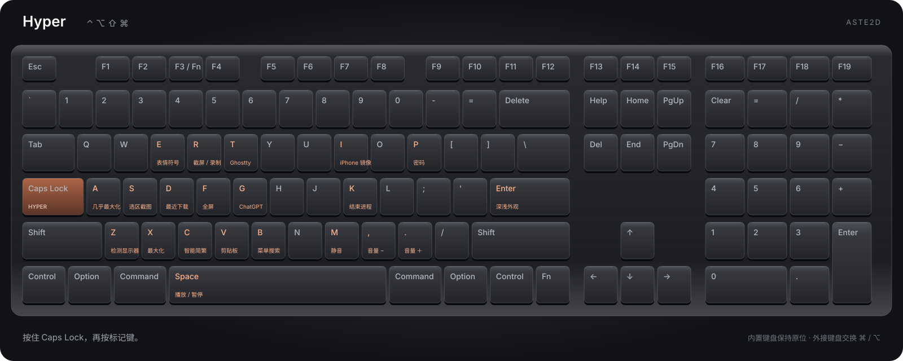

# aste2d · Mac 快速进入工作流整合包

让新 Mac 快速进入工作流的一套常用工具与键盘配置。用 Hyper 控制媒体、管理窗口、截图和转换简繁文字，把常用操作集中到键盘上。

**[在线查找快捷键](https://aste2d.github.io/macos-kit/快捷键.html)** · [下载整合包](https://github.com/aste2d/macos-kit/releases/latest)

下载后双击 `快捷键.html`，可离线搜索、筛选和打印。

## 安装

适用于 macOS 26 或更新版本。

1. 下载并安装下方所需软件。Hyper 快捷键需要 Karabiner-Elements；应用启动、窗口管理与剪贴板搜索需要 Raycast v2。
2. 显示器检测工具需要 Apple Command Line Tools。尚未安装时运行 `xcode-select --install`，按系统提示完成安装。
3. 在整合包目录运行 `zsh setup.command --apply`，启用键盘与系统快捷键。按应用提示授予所需权限；系统快捷键如未立即生效，注销后重新登录。
4. 按 [Raycast 快捷键表](docs/raycast.md) 绑定应用和命令。主快捷键为 ⌘Space。
5. 解压 Smart Chinese，运行其中的 `install.command`。安装 Keka 和 Ghostty 后，可运行 `zsh setup.command --services` 启用对应的系统服务快捷键。

## 软件

| 软件 | 版本 | 官方下载 | 国内网络备用 |
|---|---|---|---|
| Raycast v2 | 2.11.1.0 | [官网](https://www.raycast.com/download) | 暂无核实的独立国内镜像，使用官网 |
| Karabiner-Elements | 16.3.0 | [官方 DMG](https://github.com/pqrs-org/Karabiner-Elements/releases/download/v16.3.0/Karabiner-Elements-16.3.0.dmg) | [备用下载](https://gh-proxy.com/https://github.com/pqrs-org/Karabiner-Elements/releases/download/v16.3.0/Karabiner-Elements-16.3.0.dmg) |
| Mac Mouse Fix | 3.1.0 | [官方 ZIP](https://github.com/noah-nuebling/mac-mouse-fix/releases/download/3.1.0/MacMouseFixApp.zip) | [备用下载](https://gh-proxy.com/https://github.com/noah-nuebling/mac-mouse-fix/releases/download/3.1.0/MacMouseFixApp.zip) |
| Clash Verge Rev | 2.5.10 | [Apple 芯片](https://github.com/clash-verge-rev/clash-verge-rev/releases/download/v2.5.10/Clash.Verge_2.5.10_aarch64.dmg) · [Intel](https://github.com/clash-verge-rev/clash-verge-rev/releases/download/v2.5.10/Clash.Verge_2.5.10_x64.dmg) | **[Apple 芯片直链](https://gh-proxy.com/https://github.com/clash-verge-rev/clash-verge-rev/releases/download/v2.5.10/Clash.Verge_2.5.10_aarch64.dmg) · [Intel 直链](https://gh-proxy.com/https://github.com/clash-verge-rev/clash-verge-rev/releases/download/v2.5.10/Clash.Verge_2.5.10_x64.dmg)** |
| Ghostty | 1.4.0 | [官网下载](https://ghostty.org/download) | 官网；暂无核实的独立国内镜像 |
| SyncClipboard | 3.3.3 | [Apple 芯片](https://github.com/Jeric-X/SyncClipboard/releases/download/v3.3.3/SyncClipboard_macos_arm64.dmg) · [Intel](https://github.com/Jeric-X/SyncClipboard/releases/download/v3.3.3/SyncClipboard_macos_x64.dmg) | [Apple 芯片备用](https://gh-proxy.com/https://github.com/Jeric-X/SyncClipboard/releases/download/v3.3.3/SyncClipboard_macos_arm64.dmg) · [Intel 备用](https://gh-proxy.com/https://github.com/Jeric-X/SyncClipboard/releases/download/v3.3.3/SyncClipboard_macos_x64.dmg) |
| Keka | 1.6.8 | [官网](https://www.keka.io/zh-cn/) | 官网直接下载；App Store 是另一分发渠道 |
| 智能简繁 Smart Chinese | 1.1.0 | [通用安装包](https://github.com/aste2d/smart-chinese/releases/download/v1.1.0/Smart-Chinese-1.1.0-macOS-universal.zip) | [备用下载](https://gh-proxy.com/https://github.com/aste2d/smart-chinese/releases/download/v1.1.0/Smart-Chinese-1.1.0-macOS-universal.zip) |

国内网络无法访问 GitHub 时，可使用表中的备用下载地址。备用链接由第三方提供；下载后使用 [downloads.json](downloads.json) 中的官方 SHA-256 校验文件。

Clash Verge 可双击 `download-clash.command` 下载，也可在终端执行 `zsh download-clash.command`。脚本自动选择芯片架构、尝试备用下载源，并校验完整文件后保存到 Downloads 文件夹。网络速度和可达性因地区而异。

## 使用

按住 Caps Lock 即为 Hyper（⌃⌥⇧⌘）。轻点 Caps Lock 输出反引号，同时按下两侧 Shift 切换大写锁定。

| 快捷键 | 功能 |
|---|---|
| Hyper+Space | 播放 / 暂停 |
| Hyper+M | 静音 / 取消静音 |
| Hyper+, / Hyper+. | 降低 / 提高音量，可长按 |
| Hyper+S 或 ⌥⇧S | 截取选区并拷贝到剪贴板 |
| Hyper+R | 打开截屏与录制选项 |
| Hyper+C | 将所选文字智能转换为简体或繁体 |
| Hyper+Z | 检测显示器 |
| Hyper+A / X / F | 几乎最大化 / 最大化 / 全屏 |
| Hyper+V | 搜索剪贴板历史 |
| Hyper+Enter | 切换深浅外观 |

**按键位置**：默认所有键盘交换左右 Command 与 Option；Apple 键盘作为例外，内置键盘及外接 Apple 键盘均保持原键位。F3 映射为 Globe（Fn），Print Screen 保持原功能；“将 F1–F12 用作标准功能键”设为 Off。键盘互换规则位于 Karabiner 的 Complex Modifications，可单独关闭。

**应用内功能键**：Minecraft / Java、屏幕共享、Apple Remote Desktop，以及常见远程控制客户端在前台时，F1–F12 直接发送标准功能键（包括 F3）。离开这些应用后恢复媒体键和 F3 → Fn。[支持的应用与扩展方法](docs/function-keys.md)。

**智能简繁**：选中可编辑文字后按 Hyper+C。简体字较多时转繁体，繁体字较多时转简体；再次按下可反向转换。转换在本机完成。

**检测显示器**：按 Hyper+Z 后松开组合键，工具会打开系统“显示器”设置并执行“检测显示器”。需要辅助功能权限，目前支持简体中文和英文系统界面。硬件连接故障可能仍需检查连接线或电源。

**文件服务**：在 Finder 中选择文件后，⌃Space 发送到 Keka；⌃T 在所选位置打开 Ghostty 窗口。服务只在适用的选择对象上显示。

**可选菜单键**：`zsh setup.command --menu` 将 Tab 设为 Minimize 菜单快捷键，仅适用于提供该菜单项的应用。

## 更新与恢复

软件通过各自的更新器或官方发布页更新。整合包更新后，重新运行 `zsh setup.command --apply`，再按快捷键表补充 Raycast 绑定。

安装程序会保留其他 Karabiner 配置，并在 `~/Library/Application Support/aste2d macOS Kit/` 保存安装前的设置。需要恢复时，可先在 Karabiner 中切回原配置；使用备份目录中的 `karabiner.json` 恢复完整键盘配置，或用 `defaults import com.apple.symbolichotkeys 文件路径` 恢复系统快捷键。恢复整个偏好域会替换其中后续的新修改。

## 许可

配置与工具代码使用 MIT 许可。各应用使用自己的许可，部分软件提供付费功能。

[aste2d](https://github.com/aste2d/)
