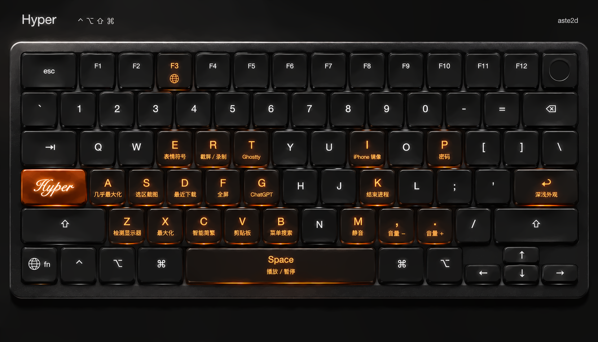
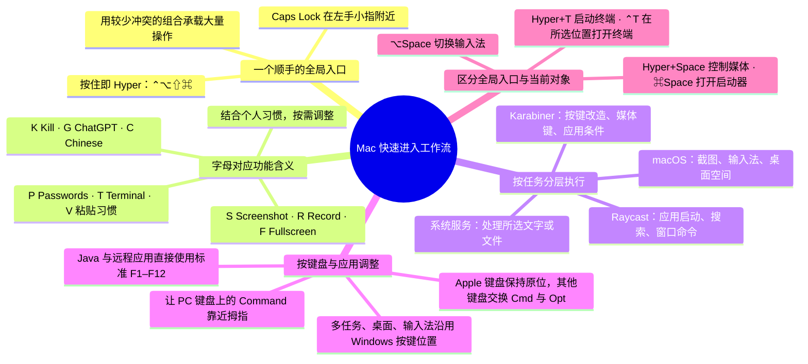

# aste2d · Mac 快速进入工作流整合包

让新 Mac 快速进入工作流的一套常用工具与键盘配置。用 Hyper 控制媒体、管理窗口、截图和转换简繁文字，把常用操作集中到键盘上。

**[在线查找快捷键](https://aste2d.github.io/macos-kit/快捷键.html)** · [下载整合包](https://github.com/aste2d/macos-kit/releases/latest)

## 配置思路

## 快捷键列表

**Hyper = ⌃⌥⇧⌘**，按住 Caps Lock 后再按对应键。字母助记结合了功能含义与个人习惯，可在 Karabiner、Raycast 和系统设置中调整。

### Hyper 全局操作

| 按键 | 功能 | 执行工具 |
|---|---|---|
| Hyper+P | 密码 | Raycast |
| Hyper+G | ChatGPT | Raycast |
| Hyper+T | Ghostty 终端 | Raycast |
| Hyper+I | iPhone 镜像 | Raycast |
| Hyper+V | 剪贴板历史 | Raycast |
| Hyper+D | 最近下载 | Raycast |
| Hyper+E | 表情与符号 | Raycast |
| Hyper+K | 结束进程 | Raycast |
| Hyper+B | 菜单栏搜索 | Raycast |
| Hyper+A | 几乎最大化 | Raycast |
| Hyper+X | 最大化 | Raycast |
| Hyper+F | 切换全屏 | Raycast |
| Hyper+Enter | 切换深浅外观 | Raycast |
| Hyper+Space | 播放 / 暂停 | Karabiner |
| Hyper+M | 静音 / 取消静音 | Karabiner |
| Hyper+, | 降低音量 | Karabiner |
| Hyper+. | 提高音量 | Karabiner |
| Hyper+C | 智能简繁转换 | Smart Chinese |
| Hyper+R | 截屏和录制选项 | macOS |
| Hyper+S | 将所选区域的图片拷贝到剪贴板 | macOS |
| Hyper+Z | 检测显示器 | 显示器工具 |

### 入口、系统与当前对象

| 按键 | 功能 | 执行工具 |
|---|---|---|
| ⌘Space | 打开 Raycast | Raycast |
| ⌥1 | 访达 | Raycast |
| ⌥4 | 音乐 | Raycast |
| ⌥2 | Discord | Raycast |
| ⌥3 | Google Chrome | Raycast |
| ⌘\ | 搜索文件 | Raycast |
| ⌥⇧S | 将所选区域拷贝到剪贴板 | Karabiner |
| 按住 Caps Lock | Hyper：⌃⌥⇧⌘ | Karabiner |
| 轻点 Caps Lock | 反引号（&#96;） | Karabiner |
| 左 Shift + 右 Shift | 切换大写锁定 | Karabiner |
| ⌃Space | 发送到 Keka（选中文件） | 服务 |
| ⌃T | 在所选位置打开 Ghostty 终端 | 服务 |
| ⌘Esc | 游戏叠层 | macOS |
| ⌘&#96; | 将焦点移到下一个窗口 | macOS |
| ⌥Tab | 调度中心 | macOS |
| ⌥&#96; | 应用程序窗口 | macOS |
| ⌥⌘D | 打开/关闭隐藏程序坞 | macOS |
| ⌥Space | 切换到下一个输入法 | macOS |
| ⌥⌘Space | 显示“聚焦”搜索 | macOS |
| Fn+⌃⌥← | 向左切换桌面空间 | macOS |
| Fn+⌃⌥→ | 向右切换桌面空间 | macOS |
| ⇧⌘/ | 显示帮助菜单 | macOS |
| Tab | 最小化窗口（按需启用） | 应用菜单 |
| Command ↔ Option | 交换 Command 与 Option（Apple 键盘除外） | Karabiner |
| F3 | Globe（Fn） | Karabiner |
| F1–F12 | 标准功能键（Java / 远程应用前台） | Karabiner |

完整列表支持[在线搜索](https://aste2d.github.io/macos-kit/快捷键.html)，下载后也可双击 `快捷键.html` 离线查看、筛选和打印。

## 安装

按系统版本选择 Raycast：

| 系统版本 | Raycast 版本 |
|---|---|
| macOS 15（Sequoia） | **Raycast v1** |
| macOS 26（Tahoe）及以上 | **Raycast v2**（Apple 芯片） |

Raycast v2 的系统与芯片要求见[官方说明](https://www.raycast.com/new)。Intel Mac 使用 Raycast v1。其他软件请按各自下载页的系统要求选择版本。

1. 下载并安装下方所需软件。Hyper 快捷键需要 Karabiner-Elements；应用启动、窗口管理与剪贴板搜索需要对应系统版本的 Raycast。
2. 显示器检测工具需要 Apple Command Line Tools。尚未安装时运行 `xcode-select --install`，按系统提示完成安装。
3. 在整合包目录运行 `zsh setup.command --apply`，启用键盘与系统快捷键。按应用提示授予所需权限；系统快捷键如未立即生效，注销后重新登录。
4. 按 [Raycast 快捷键表](docs/raycast.md) 绑定应用和命令。主快捷键为 ⌘Space。
5. 解压 Smart Chinese，运行其中的 `install.command`。安装 Keka 和 Ghostty 后，可运行 `zsh setup.command --services` 启用对应的系统服务快捷键。

## 软件

| 软件 | 版本 | 官方下载 | 镜像链接 |
|---|---|---|---|
| Raycast v1（macOS 15） | 1.x | [官网 → Download V1](https://www.raycast.com/) | — |
| Raycast v2（macOS 26+） | 2.11.1.0 | [官网](https://www.raycast.com/download) | — |
| Karabiner-Elements | 16.3.0 | [官方 DMG](https://github.com/pqrs-org/Karabiner-Elements/releases/download/v16.3.0/Karabiner-Elements-16.3.0.dmg) | [镜像链接](https://gh-proxy.com/https://github.com/pqrs-org/Karabiner-Elements/releases/download/v16.3.0/Karabiner-Elements-16.3.0.dmg) |
| Mac Mouse Fix | 3.1.0 | [官方 ZIP](https://github.com/noah-nuebling/mac-mouse-fix/releases/download/3.1.0/MacMouseFixApp.zip) | [镜像链接](https://gh-proxy.com/https://github.com/noah-nuebling/mac-mouse-fix/releases/download/3.1.0/MacMouseFixApp.zip) |
| Clash Verge Rev | 2.5.10 | [Apple 芯片](https://github.com/clash-verge-rev/clash-verge-rev/releases/download/v2.5.10/Clash.Verge_2.5.10_aarch64.dmg) · [Intel](https://github.com/clash-verge-rev/clash-verge-rev/releases/download/v2.5.10/Clash.Verge_2.5.10_x64.dmg) | **[Apple 芯片镜像链接](https://gh-proxy.com/https://github.com/clash-verge-rev/clash-verge-rev/releases/download/v2.5.10/Clash.Verge_2.5.10_aarch64.dmg) · [Intel 镜像链接](https://gh-proxy.com/https://github.com/clash-verge-rev/clash-verge-rev/releases/download/v2.5.10/Clash.Verge_2.5.10_x64.dmg)** |
| Ghostty | 1.4.0 | [官网下载](https://ghostty.org/download) | — |
| SyncClipboard | 3.3.3 | [Apple 芯片](https://github.com/Jeric-X/SyncClipboard/releases/download/v3.3.3/SyncClipboard_macos_arm64.dmg) · [Intel](https://github.com/Jeric-X/SyncClipboard/releases/download/v3.3.3/SyncClipboard_macos_x64.dmg) | [Apple 芯片镜像链接](https://gh-proxy.com/https://github.com/Jeric-X/SyncClipboard/releases/download/v3.3.3/SyncClipboard_macos_arm64.dmg) · [Intel 镜像链接](https://gh-proxy.com/https://github.com/Jeric-X/SyncClipboard/releases/download/v3.3.3/SyncClipboard_macos_x64.dmg) |
| Keka | 1.6.8 | [官网](https://www.keka.io/zh-cn/) | — |
| 智能简繁 Smart Chinese | 1.1.0 | [通用安装包](https://github.com/aste2d/smart-chinese/releases/download/v1.1.0/Smart-Chinese-1.1.0-macOS-universal.zip) | [镜像链接](https://gh-proxy.com/https://github.com/aste2d/smart-chinese/releases/download/v1.1.0/Smart-Chinese-1.1.0-macOS-universal.zip) |

可通过表中的镜像链接下载，使用 [downloads.json](downloads.json) 中的 SHA-256 校验文件。

Clash Verge 可双击 `download-clash.command` 下载，也可在终端执行 `zsh download-clash.command`。脚本自动选择芯片架构、尝试镜像链接，并校验完整文件后保存到 Downloads 文件夹。

## 使用

按住 Caps Lock 即为 Hyper（⌃⌥⇧⌘）。轻点 Caps Lock 输出反引号，同时按下两侧 Shift 切换大写锁定。

**按键位置**：默认所有键盘交换左右 Command 与 Option；Apple 键盘作为例外，内置键盘及外接 Apple 键盘均保持原键位。F3 映射为 Globe（Fn），Print Screen 保持原功能；“将 F1–F12 用作标准功能键”设为 Off。键盘互换规则位于 Karabiner 的 Complex Modifications，可单独关闭。

**应用内功能键**：Minecraft / Java、屏幕共享、Apple Remote Desktop，UU 远程、Chrome Remote Desktop（PWA），以及其他常见远程控制客户端在前台时，F1–F12 直接发送标准功能键（包括 F3）。离开这些应用后恢复媒体键和 F3 → Fn。[支持的应用与扩展方法](docs/function-keys.md)。

**智能简繁**：选中可编辑文字后按 Hyper+C。简体字较多时转繁体，繁体字较多时转简体；再次按下可反向转换。转换在本机完成。

**检测显示器**：按 Hyper+Z 后松开组合键，工具会打开系统“显示器”设置并执行“检测显示器”。需要辅助功能权限，目前支持简体中文和英文系统界面。

**鼠标滚轮**：通过一条 `Reverse mouse vertical scroll wheel` 复杂规则统一反转垂直滚轮。在 Karabiner 的 Devices 中启用需要接管的鼠标即可；设备单独的滚轮反转开关保持关闭，避免重复反转。水平滚轮和指针移动保持原方向。

**文件服务**：在 Finder 中选择文件后，⌃Space 发送到 Keka；⌃T 在所选位置打开 Ghostty 窗口。服务只在适用的选择对象上显示。

**可选菜单键**：`zsh setup.command --menu` 将 Tab 设为 Minimize 菜单快捷键，仅适用于提供该菜单项的应用。

## 更新与恢复

软件通过各自的更新器或官方发布页更新。整合包更新后，重新运行 `zsh setup.command --apply`，再按快捷键表补充 Raycast 绑定。

安装程序会保留其他 Karabiner 配置，并在 `~/Library/Application Support/aste2d macOS Kit/` 保存安装前的设置。需要恢复时，可先在 Karabiner 中切回原配置；使用备份目录中的 `karabiner.json` 恢复完整键盘配置，或用 `defaults import com.apple.symbolichotkeys 文件路径` 恢复系统快捷键。恢复整个偏好域会替换其中后续的新修改。

## 许可

配置与工具代码使用 MIT 许可。各应用使用自己的许可，部分软件提供付费功能。

[aste2d](https://github.com/aste2d/)
